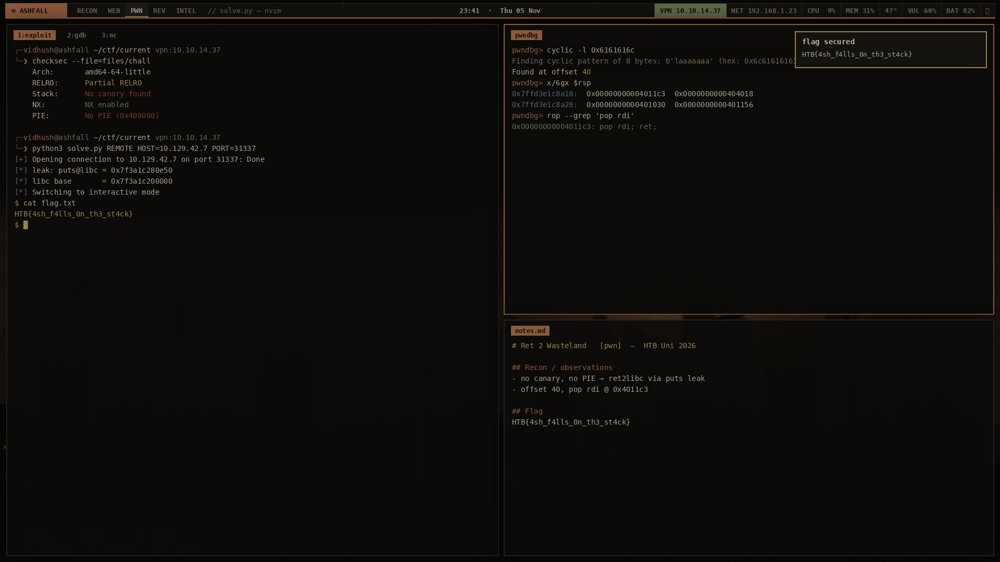

# ☢ ASHFALL — niri rice for CTF operators

Nuclear-winter palette (ash · bone · rust · dull ochre · moss). Nothing bright made it.
Tested against **niri 26.04's** config parser.



## Install
Arch Linux only. Run as your normal user (it uses sudo for packages).
```bash
git clone https://github.com/vidhush-adithya/ashfall.git && cd ashfall
./install.sh            # desktop + CTF toolkit
./install.sh --no-ctf   # desktop only
./install.sh --dots     # just configs, no packages
```
The script backs up your existing configs to `~/.config/ashfall-backup-<date>/` first. It only **appends** one line to `~/.zshrc`, and it runs `niri validate` at the end.

## Workspaces (the CTF board)
| Key | Workspace | Auto-opens here |
|---|---|---|
| `Super+1` | **recon** | Wireshark, terminals |
| `Super+2` | **web** | Firefox, Burp Suite |
| `Super+3` | **pwn** | your exploit terminals |
| `Super+4` | **rev** | Ghidra, ImHex, Cutter |
| `Super+5` | **intel** | notes, Discord, Obsidian |

## Hotkeys
| Key | Action |
|---|---|
| `Super+Return` / `Super+T` | terminal (kitty) |
| `Super+Space` / `Super+D` | launcher |
| `` Super+` `` | drop-down scratch terminal |
| `Super+Shift+N` | **new challenge**: asks event, name, category, then builds `~/ctf/<event>/<cat>-<name>/` with notes + solve.py template |
| `Super+Shift+Return` | terminal inside the current challenge |
| `Super+N` | open current challenge notes |
| `Super+P` | copy your VPN (tun0) IP |
| `Super+Shift+R` | reverse-shell cheatsheet with your IP (bash one-liner copied) |
| `Super+Y` | clipboard history |
| `Super+Shift+Y` | **flag grab**: finds `xxx{...}` in clipboard history, copies it, logs it to `flags.txt` |
| `Super+B` / `Super+Shift+B` / `Super+G` / `Super+Shift+W` | Firefox / Burp / Ghidra / Wireshark |
| `Super+Shift+S` / `Print` | screenshot (for writeups) |
| `Super+O` | overview · `Super+Tab` previous workspace |
| `Super+H J K L` | move focus · add `Ctrl` to move windows |
| `Super+R` | cycle width · `Super+F` maximize · `Super+W` tabs · `Super+V` float |
| `Super+X` | power menu · `Super+Alt+L` lock |
| `Super+Shift+/` | **show all hotkeys** |

## Shell helpers (zsh)
`c` (cd to current challenge) · `nmapq <ip>` · `nmapf <ip>` · `fuzzdir <url>` · `vhosts <domain>` · `serve [port]` · `listen [port]` · `triage <file>` · `flagfind [dir]` · `ex <archive>` · `b64d/b64e/hexd/hexe/rot13/urld/urle/jwtd <str>`

**Shell features:** `↑`/`↓` search history by what you've typed · `Esc Esc` adds sudo · `Ctrl+X Ctrl+E` edits the command in nvim · `Alt+C` copies the command line · coloured, grouped Tab completion · `cd` remembers recent folders (`d`, `cd -2`) · commands over 30 s send a desktop notification when done · `ctflog` records the terminal session for writeups · unknown commands tell you which package to install · `ashfall-help` lists everything.

Custom flag format: `export FLAG_RE='flag\{[^}]+\}'` in `~/.zshrc`.

## Tweak
- Monitor: `niri msg outputs`, then edit the `output` block in `~/.config/niri/config.kdl` (saving reloads it live).
- Keyboard: Caps Lock is remapped to Escape. Remove `options "caps:escape"` if you don't want that.
- Colours: every file uses the same hex values. Search for `#8b5a3c` (rust) to change the accent.
- Wallpaper: `~/.local/share/ashfall/ashfall.png`.

## What's inside
| Path | Contents |
|---|---|
| `config/niri/config.kdl` | niri: layout, named workspaces, window rules, hotkeys |
| `config/waybar/` | top bar + VPN (tun0) readout script |
| `config/{fuzzel,mako,kitty,swaylock,btop}` | launcher, notifications, terminal, lock screen, monitor themes |
| `config/ashfall/ashfall.zsh`, `config/starship.toml` | shell layer with CTF helpers, prompt |
| `bin/` | `ctf-new`, `ctf-notes`, `ctf-ip`, `flag-grab`, `revsh`, `ashfall-clip`, `ashfall-power` |
| `wallpapers/` | original ASHFALL wallpaper + lock image |
| `tools/` | Python scripts that generate the wallpaper and preview |

## Palette
| ash | soot | slag | bone | rust | ochre | moss | blood |
|---|---|---|---|---|---|---|---|
| `#0c0b09` | `#14120f` | `#2a2620` | `#a89f8c` | `#8b5a3c` | `#9a8348` | `#5d6a48` | `#7a3329` |

## License
MIT. The reverse-shell helper is for CTFs and labs you're authorised to attack.
